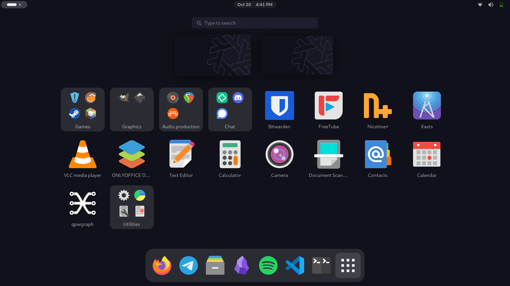
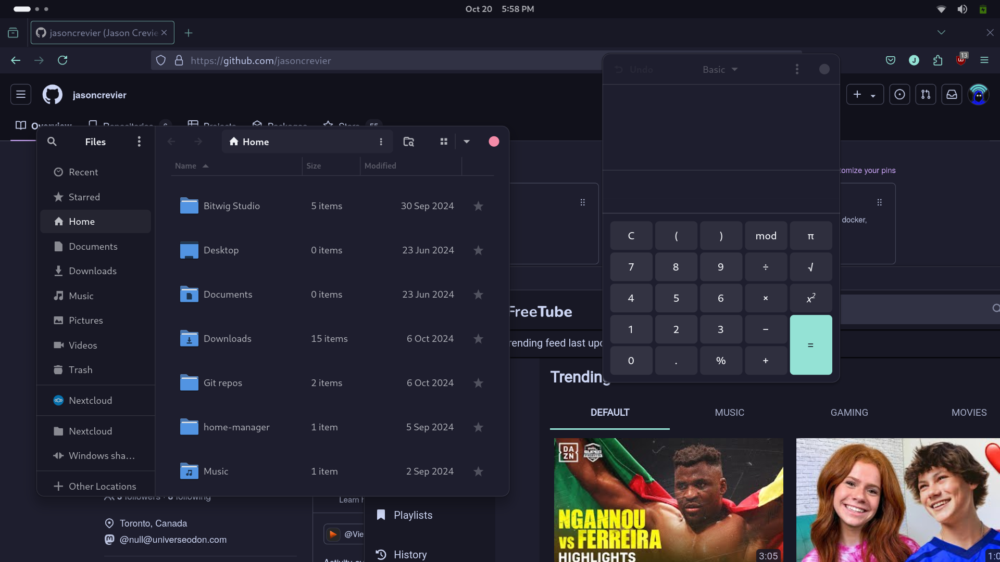
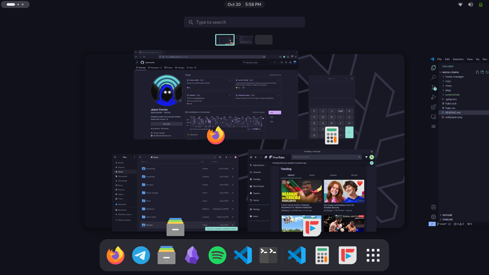
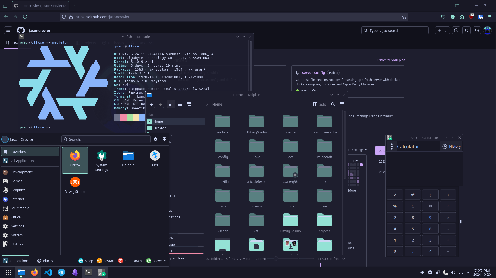

# My NixOS config
This is where I store the config files and dotfiles for my NixOS setup. I'm new to Nix in general, so there's a lot of tinkering and experimentation happening in this space.
A lot of it is still very noob-ish, so if you stumble on this repo and have any advice, I'd love to hear it!

## Structure
```console
nixos-config
├── home-manager
│   └── device-configs
├── misc
├── nixos
│   └── device-configs
├── pkgs
└── scripts
```
- `nixos-config`: Includes the main flake for all the NixOS devices in my fleet, my wallpaper, and all the sub-directories below.
- `home-manager`: Separate config files for `home-manager`, which runs as part of the system build (a single `nixos-rebuild switch` applies both). A main config file for each device imports any of the other config files from the folder that are relevant to that machine.
- `misc`: The Konsole colour scheme used by `home-manager/plasma.nix`, and `patch-vst.nix`, a shell for patching prebuilt VST plugins.
- `nixos`: Shared modules, plus a `<host>-configuration.nix` for each device in `device-configs`. Each one imports its `<host>-hardware-configuration.nix` and any of the shared modules that are relevant to that machine. Every machine imports `base.nix` (time zone, user, `git`, Nix settings, and `nh` for rebuilds and weekly cleanup). Desktop machines import `desktop.nix` instead, which pulls in `base.nix` and adds graphics, Bluetooth, Firefox and other desktop applications. `configuration-template.nix` lists the steps for adding a new machine.
- `pkgs`: Derivations for packages that aren't available in the `nixpkgs` repos.
- `scripts`: Small systemd services and timers (notifications, Navidrome → ListenBrainz sync) packaged as NixOS modules.

## Usage
These fish aliases (from `home-manager/fish.nix`) work from any directory:
- `update`: rebuild and switch the current machine.
- `upgrade`: update all flake inputs, then rebuild and switch.
- `flake-repair`: clear Nix's caches and re-fetch every flake input, for when an update gets stuck on a bad download.

Other useful commands, run from the repo:
- `nix fmt`: format every `.nix` file.
- `nix build .#amplitude` or `nix build .#bitwig-studio6`: build one of the packages in `pkgs`.
- `nix develop .#patch-vst`: a shell for patching prebuilt VST plugins (see `misc/patch-vst.nix`).

The ThinkPad, Surface and Grunt send their builds to `nix-server` (see `nixos/remote-builder.nix`).


## Devices
### Thinkpad
Specs:
- Model: **Lenovo ThinkPad T470**
- Processor: **Intel® Core™ i5-7300U**
- Graphics: **Intel® HD Graphics 620**
- Memory: **16GB**
- Storage: **256GB**

System:
- Desktop environment: **GNOME** (follows `nixos-unstable`)
- Display server: **Wayland**
- Shell: **fish**
- Theme: **Catppuccin Mocha**

<details open>
<summary>Screenshots</summary>




</details>

### Office workstation
Specs:
- Processor: **AMD Ryzen 7 5800X**
- Graphics: **Radeon 6600**
- Memory: **16GB**
- Storage: **256GB + 256GB + 1TB + 1TB**

System:
- Desktop environment: **Plasma 6**
- Display server: **Wayland**
- Shell: **fish**
- Theme: **Catppuccin Mocha**

<details open>
<summary>Screenshots</summary>


</details>

### Surface

- Desktop environment: **GNOME**
- Shell: **fish**
- Theme: **Catppuccin Mocha**

### Home server (`nix-server`)

Runs Plasma 6 (Wayland) with Sunshine for streaming, plus the always-on services: Jellyfin, Navidrome, Music Assistant, Karakeep, Ollama + Open WebUI, Wyoming (Whisper/Piper), and Valheim and Project Zomboid game servers. It is also the remote builder for the ThinkPad, Surface and Grunt.

### Grunt

A small headless server (old laptop) running Wallabag and kosync.
